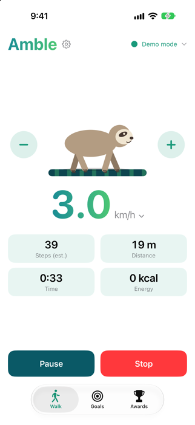
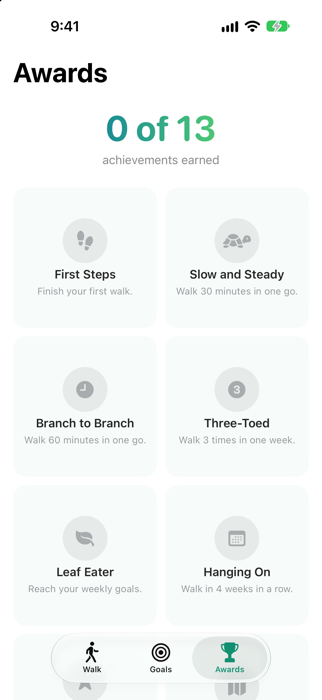

<p align="center">
  
</p>

# Amble

A calm iPhone companion for Bluetooth walking pads. Amble connects to a pad over the standard Bluetooth
fitness machine profile (FTMS), shows your walk live, controls the belt, and saves each walk to Apple Health,
which the pad vendor's own app did not do.

**[Join the public beta on TestFlight](https://testflight.apple.com/join/FdvrnEd4)** (iPhone, iOS 18 or later)

<p align="center">
  
  &nbsp;&nbsp;
  
</p>

Amble is a personal project. It is **not affiliated with** Sportstech, FITHOME or the pad's "WalkMate" brand.

> **Safety.** Amble controls a physical machine. It has only been verified with the Sportstech WalkMate; other pads
> may behave unexpectedly, for example by changing the speed on its own. Stay close, keep the belt clear when you
> start, and know how to stop the pad without the app (remote or power switch). Use it at your own risk.

## Features

- Live speed, distance, time and energy; steps are estimated (the pad reports none), see below
- Start, stop, pause and resume; speed in 0.1 km/h steps, quick speeds by tapping the speed
- Device picker that remembers the last pad and reconnects by itself, also in the background
- Each walk is saved to Apple Health as an indoor walking workout (distance, energy, estimated steps, pauses);
  walks wait in a queue while the phone is locked and are saved on unlock
- Live Activity on the lock screen and in the Dynamic Island, with slower / pause / stop / faster buttons
- Weekly goals (walks and minutes), progress rings, streaks, and 13 sloth-themed achievements,
  all computed from the walks in Health, so there is no separate database
- An animated sloth that sleeps, wakes up and walks at the pace of the belt
- Step length from Apple Health, from your height, or entered by hand
- Home screen widget (small and medium) with this week's progress
- Demo mode with a simulated pad; demo walks are not saved

## Languages

English and German. Texts live in String Catalogs (`Amble/Amble/Localizable.xcstrings`,
`Amble/AmbleWidgets/Localizable.xcstrings`, and `Amble/Amble/InfoPlist.xcstrings` for the permission prompts).
Open a catalog in Xcode to add or edit a language; new strings in the code appear there after a build.
Achievement names are in `Amble/Amble/AchievementText.swift`. The compatibility report that the app copies is
always English, so reports are easy to read for everyone.

## Requirements

- A Mac with Xcode 27 or later and [XcodeGen](https://github.com/yonaskolb/XcodeGen) (`brew install xcodegen`)
- An iPhone running iOS 18 or later. Bluetooth does not work in the simulator; demo mode (in the pad picker) does.
- An Apple ID for signing. A free one works, but apps signed with it stop launching after 7 days; press ⌘R in
  Xcode again to renew. Sharing the app with others needs a paid Apple Developer account (TestFlight).
- A walking pad that supports FTMS (see below)

## Build and run

1. Edit `Amble/project.yml`: set `DEVELOPMENT_TEAM` to your team ID and change the bundle identifiers
   (`org.biskup.amble` and `org.biskup.amble.widgets`) to ones you own. Also change the App Group
   `group.org.biskup.amble`, which appears twice in `Amble/project.yml` and once in `Amble/Shared/GoalsSnapshot.swift`;
   an App Group belongs to one team, so signing fails otherwise.
2. Generate the Xcode project (it is not checked in):

   ```bash
   cd Amble
   xcodegen generate
   open Amble.xcodeproj
   ```

3. Select your iPhone and press ⌘R. On first run, enable Developer Mode on the phone and trust your developer
   profile (Settings > General > VPN & Device Management).

After adding or removing source files, run `xcodegen generate` again.

## Tests

The protocol and the goal/achievement rules live in a Swift package that runs on the Mac:

```bash
cd AmbleCore
swift test
```

The protocol tests use byte captures from a real pad.

## Repository layout

| Path | What it is |
|---|---|
| `Amble/` | The iOS app (SwiftUI) and its Live Activity widget extension, generated from `project.yml` |
| `Amble/Amble/` | App sources: `PadConnection` (Bluetooth, walk state, Health queue), `HealthWriter`, views, stores |
| `Amble/AmbleWidgets/` | Live Activity (lock screen and Dynamic Island) |
| `Amble/Shared/` | Code used by both: theme, sloth artwork, Live Activity state, App Intents for its buttons |
| `AmbleCore/` | Pure Swift package: FTMS parsing and commands, step estimate, weekly progress, achievements, with tests |
| `tools/probe/` | Mac command-line tool used to reverse-engineer the pad |

## How steps are estimated

The pad reports no steps, and walking is not one fixed stride: the slower you walk, the shorter and the more frequent
your steps are. `StepModel` in `AmbleCore` uses the usual linear relation between walking speed and cadence
(about +13 steps per minute for each extra km/h, an average from gait studies) and anchors it to your step length at a
normal pace (4.7 km/h), from Apple Health, your height or your own entry. `StepCounter` adds up steps whenever the
pad's distance grows, using the speed at that moment, so speed changes during a walk are followed. For a 1.73 m adult
the model gives about 74 steps per minute at 2 km/h and about 100 at 4 km/h. Counts stay approximate.

## How Amble talks to the pad

The pad exposes the standard FTMS service (`0x1826`), so no vendor protocol is needed:

| Characteristic | Use |
|---|---|
| `2ACD` Treadmill Data | about 2 notifications per second: speed (0.01 km/h), total distance (m), energy, elapsed time |
| `2AD9` Control Point | write: request control `00`, start / resume `07`, stop `08 01`, pause `08 02`, set speed `02 <u16 LE, 0.01 km/h>`; replies as indications `80 <opcode> 01` |
| `2AD3` Training Status | `01` idle, `0e` starting (about 3.5 s countdown), `0d` running, `0f` stopping |
| `2ADA` Machine Status | `04` started, `02 01` stopped, `02 02` paused |
| `2AD4` Supported Speed Range | 1.0 to 6.0 km/h in 0.1 steps |

Things that are not obvious, all verified on the pad:

- The pad does not announce its state on connect, so Amble reads the training status once when it connects.
- A pause also reports "idle". It is told apart from a stop by the machine status (`02 02`).
- The pad's counters persist between sessions, so Amble measures every walk from its own baseline.
- The pad takes one Bluetooth connection at a time: close the vendor app (and Amble) before using another tool.

### Other pads

Any pad with FTMS Treadmill Data and a control point should work in principle. The pad does not have to
advertise the service; Amble checks after connecting and refuses devices without it. To find out what a pad
supports, use the probe tool below. Quirks such as a vendor "unlock" step before commands are accepted
exist on some pads; this one needs none.

Amble has been verified with one pad model. See [COMPATIBILITY.md](COMPATIBILITY.md) for the list and for how
to report yours (Settings > Pad compatibility > Copy report). Without a pad, the pad picker offers a demo mode
with a simulated pad; demo walks are not saved to Health.

## The Mac probe tool

`tools/probe` scans, connects, dumps every service, and logs notifications. Build and run it:

```bash
cd tools/probe
swiftc -O probe.swift -o probe -Xlinker -sectcreate -Xlinker __TEXT -Xlinker __info_plist -Xlinker Info.plist
./probe scan 15                       # list nearby devices
./probe connect <name> 30             # read-only: dump services, log data for 30 s
./probe ctl <name> req start wait=8 pause wait=8 start wait=8 stop   # sends commands
```

`scan` and `connect` never write. **`ctl` sends commands to the pad and the belt will move**: keep it clear,
and Ctrl-C sends a stop. Your terminal asks for Bluetooth permission the first time.

## Design notes

- **Steps are estimated** as distance divided by step length, because the pad reports none. The step length
  comes from Health, your height (41% of it) or manual entry. It is shorter at slow belt speeds, so expect
  approximate numbers. A time-based calibration is on the backlog.
- **History comes from Health**, not from a private database. Amble reads back the workouts it wrote. Only the
  dates of earned achievements and the goals are stored on the phone.
- **Live Activities** cannot animate continuously and can only be started while the app is in the foreground;
  updates and the buttons work in the background.

## License

[MIT](LICENSE).

Privacy: Amble collects nothing and sends nothing; see [PRIVACY.md](PRIVACY.md) ([Deutsch](PRIVACY.de.md)).
